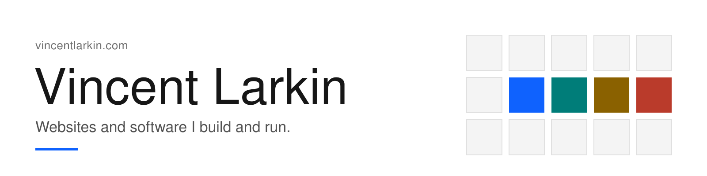
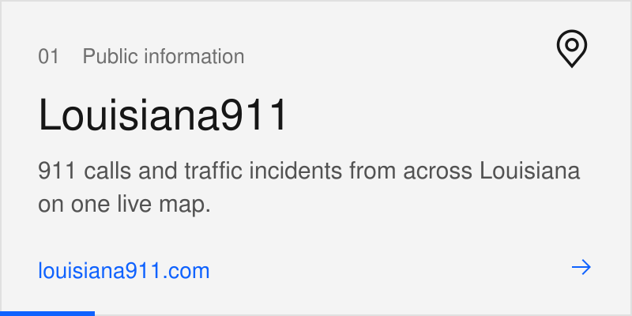
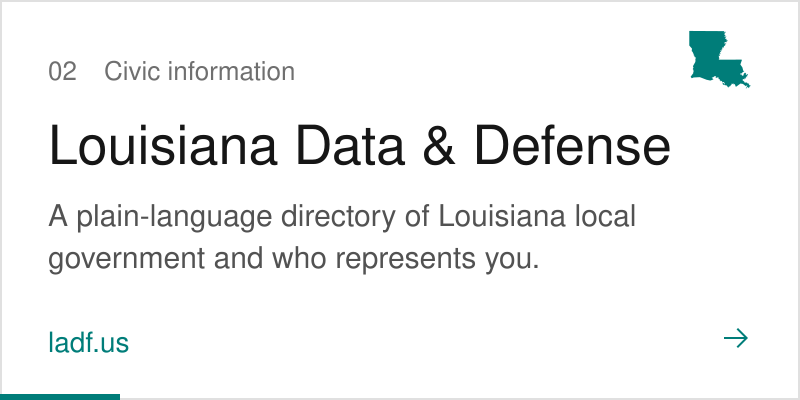
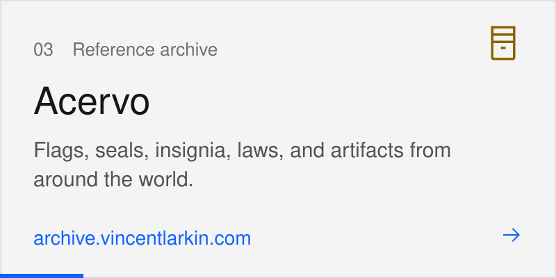
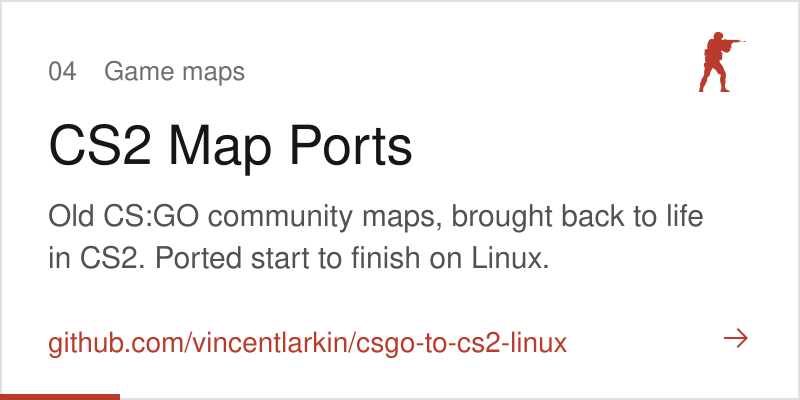

<a href="https://vincentlarkin.com">
  <picture>
    <source media="(prefers-color-scheme: dark)" srcset="assets/header-dark.svg">
    
  </picture>
</a>

<a href="https://louisiana911.com"><picture><source media="(prefers-color-scheme: dark)" srcset="assets/project-01-dark.svg"></picture></a>
<a href="https://ladf.us"><picture><source media="(prefers-color-scheme: dark)" srcset="assets/project-02-dark.svg"></picture></a>
<a href="https://archive.vincentlarkin.com"><picture><source media="(prefers-color-scheme: dark)" srcset="assets/project-03-dark.svg"></picture></a>
<a href="https://larkincomputingbureau.com"><picture><source media="(prefers-color-scheme: dark)" srcset="assets/project-04-dark.svg"></picture></a>

> For to set the mind on the flesh is death, but to set the mind on the Spirit is life and peace. — Romans 8:6

[vincentlarkin.com](https://vincentlarkin.com) · [contact@vincentlarkin.com](mailto:contact@vincentlarkin.com) · Set in IBM Plex with Carbon Design System colors and icons
